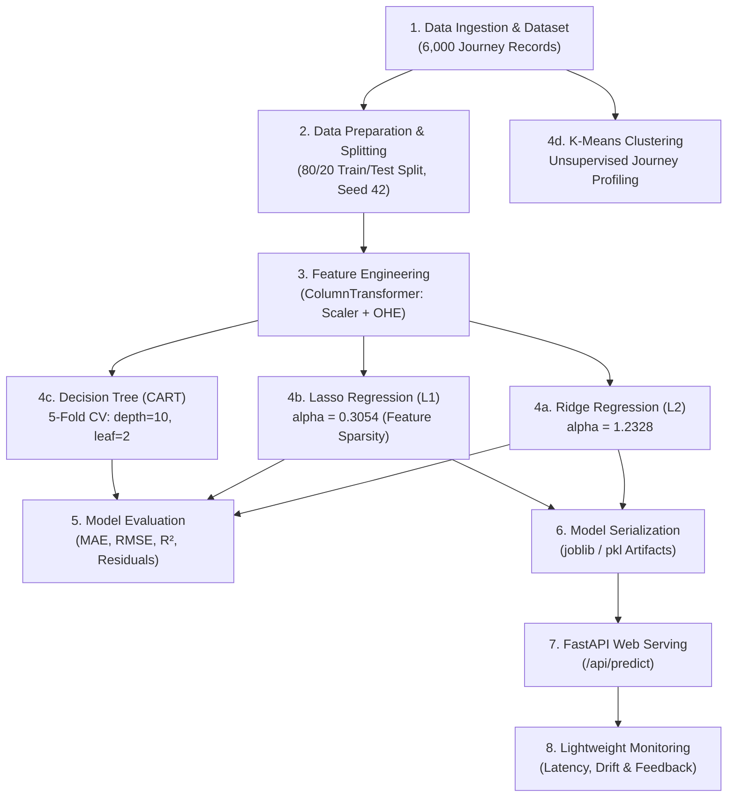
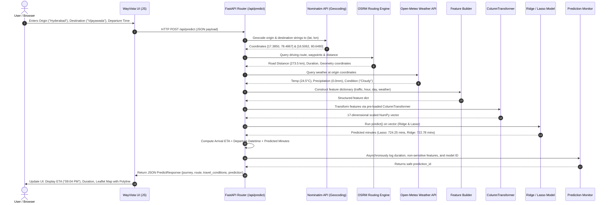

# End-to-End Machine Learning Lifecycle (Course Outcome 1)
## WayVista / VoyageML — Intelligent Journey Time Predictor

This document outlines the complete machine learning lifecycle of the WayVista project, satisfying **Course Outcome 1 (CO1)**. It explains data preparation, feature engineering, model training, evaluation, serving architecture, and traces how an end-to-end prediction request travels from user interaction to model inference and back.

---

## 1. Lifecycle Overview & Architecture

The machine learning lifecycle follows an iterative, production-ready pipeline:

---

## 2. Step-by-Step Lifecycle Stages

### Stage 1: Problem Formulation & Dataset Construction
- **Objective:** Predict real-world road journey durations (`travel_time_minutes`) and arrival ETA given trip origin, destination, departure time, and environmental conditions.
- **Dataset (`ml/dataset/travel_dataset.csv`):** 6,000 synthesized journey records spanning short intra-city trips ($1.0$ km) to cross-state highway journeys ($2000.0$ km).
- **Core Attributes:**
  - `distance_km`: Continuous road distance.
  - `traffic_condition`: Categorical (`Low`, `Medium`, `High`).
  - `weather`: Categorical (`Clear`, `Cloudy`, `Rainy`, `Foggy`).
  - `day_of_week`: Categorical (`Monday` through `Sunday`).
  - `departure_hour`: Discrete integer ($0$ to $23$).
  - `temperature_c`: Ambient temperature in Celsius ($15.0$ to $42.0$ °C).
  - `travel_time_minutes`: Target continuous duration including traffic delays and highway rest stops for trips $>300$ km.

### Stage 2: Data Preprocessing & Leakage Prevention
- **Split:** Reproducible 80% training ($4,800$ samples) and 20% testing ($1,200$ samples) using `random_state=42`.
- **Data Leakage Safeguard:** The Scikit-Learn `ColumnTransformer` is fitted **strictly on `X_train`**. The held-out test set `X_test` and live production inputs are only transformed using the pre-fitted parameters.
- **Transformations:**
  - `StandardScaler`: Applied to numeric features (`distance_km`, `departure_hour`, `temperature_c`) to produce zero mean and unit variance.
  - `OneHotEncoder`: Applied to categorical features with explicit category lists to ensure deterministic 17-dimensional vector ordering.

### Stage 3: Supervised Model Training
- **Ridge Regression ($L_2$):** Penalizes sum of squared weights ($\lambda \sum w_j^2$). Hyperparameter $\alpha = 1.2328$ chosen via 5-fold cross-validation over 100 log-spaced values. Prevents multicollinearity instability.
- **Lasso Regression ($L_1$):** Penalizes sum of absolute weights ($\lambda \sum |w_j|$). Hyperparameter $\alpha = 0.3054$ chosen via 5-fold cross-validation. Enforces sparsity, driving 4 redundant categorical coefficients to exactly $0.0$.
- **Decision Tree Regressor (CART):** Non-linear recursive binary splitting. Hyperparameters selected via 5-fold CV grid search on `X_train` (`max_depth=10, min_samples_leaf=2, min_samples_split=10`). Captures non-linear rest-stop thresholds and distance speed tiers.

### Stage 4: Unsupervised Journey Profiling (K-Means)
- Scaled clustering on `distance_km` and `travel_time_minutes` with `random_state=42`.
- Evaluated $k=2$ through $k=6$ using Inertia and Silhouette scores.
- Empirically selected $k=3$ as the optimal inertia elbow (-52.6% drop to $1358.58$) with high Silhouette score ($0.6429$).
- Yielded 3 statistically grounded journey clusters:
  1. **Short Journeys:** Mean $161.3$ km, $164.4$ mins (62.1% of dataset)
  2. **Medium Regional Journeys:** Mean $809.3$ km, $792.5$ mins (22.5% of dataset)
  3. **Long Interstate Journeys:** Mean $1605.6$ km, $1561.1$ mins (15.5% of dataset)

### Stage 5: Evaluation & Validation
- Evaluation across identical held-out test splits:
  - **Lasso Regression:** Test $R^2 = 0.9662$, Test MAE = $71.12$ mins, Test RMSE = $102.71$ mins.
  - **Ridge Regression:** Test $R^2 = 0.9662$, Test MAE = $71.41$ mins, Test RMSE = $102.63$ mins.
  - **Decision Tree:** Test $R^2 = 0.9856$, Test MAE = $37.91$ mins, Test RMSE = $66.91$ mins.
- Generalization gap ($R^2_{train} - R^2_{test}$) verified near zero for all models, ruling out overfitting.

### Stage 6: Deployment, Serving & Monitoring
- FastAPI asynchronous application server loading serialized model artifacts into memory on startup.
- Real-time weather and routing engine integration.
- Prediction monitoring logging latency, status, and input distributions safely without storing PII or raw GPS coordinates.

---

## 3. End-to-End Prediction Request Journey

Below is the detailed flow of how an incoming request travels from the browser UI to the ML models and back:

---

## 4. Summary of Preservation & Isolation Guarantees

- **No Retraining of Existing Models:** The pre-trained Ridge and Lasso joblib artifacts retain their original weights, hyperparameters, and predictions.
- **Zero Disruption to Existing Services:** Authentication, navigation, Leaflet mapping, OSRM routing, and weather services operate without modifications to their core logic.
- **Safe Monitoring:** Monitoring runs in isolated try/except blocks, guaranteeing that monitoring file operations never fail a user prediction request.
